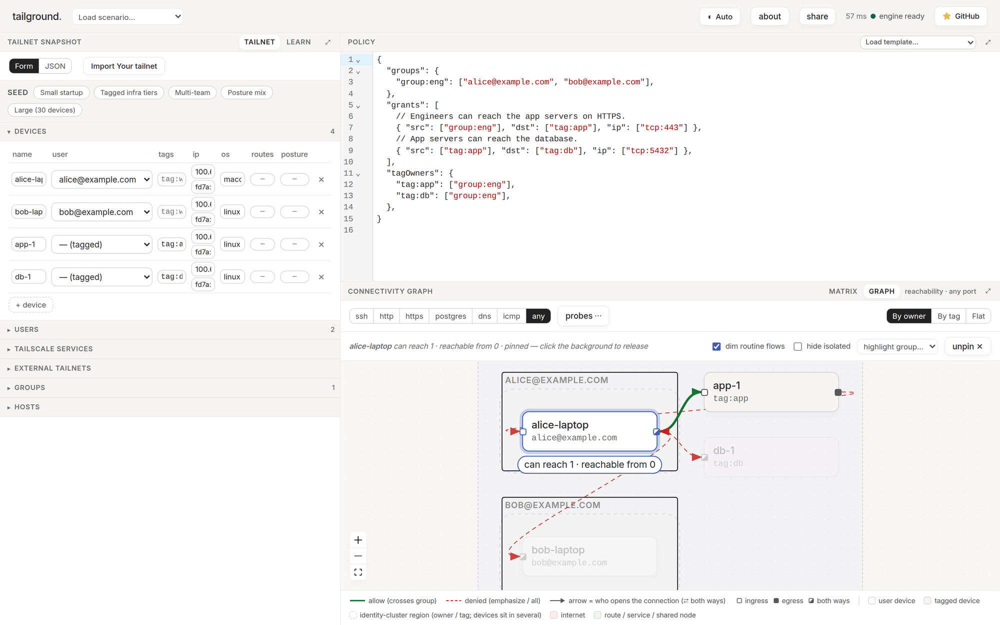

<h1 align="center">
  
</h1>

<p align="center">
  
</p>


A browser-based playground for learning, writing, and visualizing **Tailscale
policy files** ([syntax reference][policy-file syntax reference]) — write a policy, drop in a mock tailnet of devices and users, and
verify which connections it allows or denies.

The policy is evaluated by a real engine: [Headscale]'s open-source
reimplementation of Tailscale's ACL compiler, plus Tailscale's own packet-filter
matcher, compiled to WebAssembly and run entirely in your browser. Evaluation
needs no backend or account. Sharing prefers an optional SQLite-backed short-link
API; if unavailable, the full scenario is encoded in the URL fragment.

**Try it live: <https://tailground.frozenspace.eu>**



## Features

**Write and check policy**

- **Policy editor** for HuJSON (comments and trailing commas), with schema-aware
  autocomplete, hover help, and inline error markers from both the schema and the
  engine itself.
- **Starter templates** (default-deny, tag-based tiers, SSH accept vs check,
  application capabilities, posture-gated admin) and **matched scenarios** that
  load a policy and tailnet together.
- **`tests` and `sshTests`** blocks run as assertions, so a policy can lock in the
  behaviour you want.

**Model your tailnet**

- **Mock tailnet** of users (with roles), devices (tags, OS, IPs, routes, posture),
  groups, hosts, Tailscale Services and external tailnets, edited as a form or as
  raw JSON.
- **Seeds** for common shapes, from a small startup to a 30-device tailnet.
- **Import your real tailnet** from `tailscale status --json` or a saved API
  device list. The paste is parsed in your browser and never sent anywhere.

**See what's allowed**

- **Connection matrix** showing which source reaches which destination per
  protocol and port (with your own probes), grouped by owner or tag. SSH results
  show accept, check or reject for any login user.
- **Pair detail and device inspector**: click a cell for the verdict on every
  probe, or a device for its compiled packet filter, node capabilities and
  inbound SSH rules.
- **Connectivity graph** of the same result, with hover-to-trace, pinning,
  grouping, and filters to declutter large tailnets.
- **Policy features beyond plain ACLs:** `grants` (including application
  capabilities and `via`), `ssh`, `nodeAttrs`, `autoApprovers`, `ipsets`,
  device posture (including custom attributes), role autogroups such as
  `autogroup:admin`, subnet routers and exit nodes, Tailscale Services, and
  declarative node sharing across tailnets. An **About** panel lists what the
  engine evaluates, what Tailground adds on top, and what isn't simulated.

**Learn**

- **Guided lessons**, from your first tailnet through grants, SSH, posture,
  subnet routes, services and node sharing. Most are graded live against the
  lesson's `tests` block.

**Share**

- **Share links** that carry your policy, tailnet, probes and current view. Use a
  long link (the whole scenario is in the URL fragment, nothing stored) or a
  short link (kept on the optional short-link server for a year after last
  opened). Anyone opening a link is asked before it loads.

**Everything else**

- **Runs entirely in your browser.** Evaluation needs no backend or account.
- **Resizable, collapsible panels** with a saved layout, and a mobile layout.
- **Light, dark and auto themes**, following your OS.

## Develop

Requires Go 1.27+ and Node 20+. The engine builds against a sibling checkout of
Headscale (`go.mod` replaces `github.com/juanfont/headscale` with `../headscale`).
Check out the commit CI pins (`HEADSCALE_REF` in `.github/workflows/ci.yml`):

```sh
git clone https://github.com/juanfont/headscale ../headscale
git -C ../headscale checkout 63123196cc21eeb301eec60bf05d5fe0a2bc4787
```

```sh
make vendor       # once, and after any dependency bump (vendors Headscale and applies engine/vendor-trim/capabilities.patch)
make web-install  # once — npm install for the SPA
make web-dev      # build the WASM engine + run the Vite dev server
make web-build    # build the engine + the static site into web/dist
```

`vendor/`, `web/public/engine.wasm` and `wasm_exec.js` are generated and
git-ignored. Never hand-edit `vendor/`: change the patch and rerun `make vendor`.
To try sharing locally, run the short-link API with `go run ./server`; Vite
proxies `/api` to it on `127.0.0.1:8081`.

### Test and check

```sh
make test                          # root module: go test ./...
(cd server && go test ./...)       # short-link API, a separate Go module
make e2e-offline                   # PR-safe offline differential-harness checks
cd web && npm run typecheck && npm test   # tsc --noEmit, then vitest

gofmt -l engine/                   # must print nothing (CI enforces it)
go vet ./...                       # run in the repo root and in server/
```

`make e2e` runs the harness against real disposable tailnets and needs Tailscale
OAuth credentials (`TS_OAUTH_CLIENT_ID` / `TS_OAUTH_CLIENT_SECRET`); CI only runs
the offline subset.

### Other tools

```sh
go run ./engine/cli -demo | jq .   # evaluate the built-in scenario
make build                         # build the CLI harness (bin/tg-eval)
make spike                         # WASM engine + the no-build smoke page at :8080/spike.html
make size                          # report the WASM bundle size
```

Contributor and agent notes (layout, gotchas, test conventions) are in
[AGENTS.md](./AGENTS.md).

## Deploy

The site is one container image (nginx serving the SPA, plus the short-link API
as a sidecar) deployed with the manifests in `deploy/k8s`. It expects a
Kubernetes Gateway API gateway and a default StorageClass.

```sh
make image-push                    # build and push the image (:latest and a timestamped tag)
make k8s-gateway TAILGROUND_HOST=t.example.com   # once: add the listener to the gateway
make k8s-deploy TAILGROUND_HOST=t.example.com IMAGE_TAG=20260101-abc123 STORAGE_SIZE=5Gi
```

`make k8s-deploy` requires `TAILGROUND_HOST`. Optional settings are `IMAGE_TAG`
(default `latest`), `GATEWAY_NAME` and `GATEWAY_NAMESPACE` (default
`cluster-gateway` and `default`), `STORAGE_SIZE` and `STORAGE_CLASS`. Keep
`STORAGE_CLASS` the same as the existing volume claim when redeploying, because a
claim's storage class can't be changed after creation. `make k8s-rollback
TAG=<timestamp>-<sha>` re-points `:latest` at an earlier build, and
`make k8s-backup` downloads a snapshot of the short-link database.

## License

BSD-3-Clause (matches upstream Tailscale and Headscale) — see [LICENSE](./LICENSE).

[Headscale]: https://github.com/juanfont/headscale
[policy-file syntax reference]: https://tailscale.com/docs/reference/syntax/policy-file

## Credits

- [Headscale] — the policy compiler the engine is built on.
- [Tailscale](https://github.com/tailscale/tailscale) — the packet-filter matcher
  and the policy language itself.
- [React Flow](https://reactflow.dev) — the connection graph.
- [CodeMirror](https://codemirror.net) — the policy editor.
